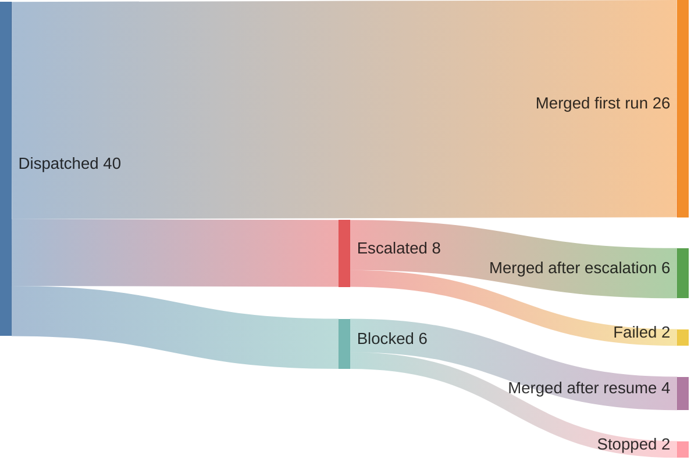

# Spec 0003: Factory metrics

Status: Draft · Owner: Dan Kuhn · Created: 2026-11-06

How the software factory measures its own efficiency and finds what changed it. Spec 0001 (Run metrics, Retrospectives) records cost and outcome per run. This spec adds what's needed to explain a change: the version of every setting on each run, a timestamp for each stage, fixed metric definitions, a replay set for testing changes, and the charts that show the results.

**Do first:** add the fields in "Changes to planned work" to the run record before workflow-loop W1-4 is built. They can't be backfilled.

## Goals

1. Every efficiency number can be split by the setting that might explain it: the issue, instructions, skills, run profile and model, gate, tests and orchestrator.
2. Fixed definitions, so a number means the same thing in every retro.
3. A change to a prompt, skill or model setting is tested on the same issues before it's adopted, not judged from the next wave's live runs.
4. Each chart answers one question that changes what the operator does next.

## Non-goals

- A metrics warehouse or BI tool. Run records and GitHub events are enough at this volume.
- Automatic changes. Metrics feed `/retro` proposals, which the operator approves; nothing tunes itself.
- Measuring the agent CLI's internals (tool calls, thinking). Outcome, cost and time per stage only.

## Design

### Settings fingerprint

Each run record carries the version of everything that shaped the run. Each field is a value the orchestrator already has or can read at sandbox start.

| Setting | Field | Value |
| --- | --- | --- |
| The issue | `issueSha` | SHA-256 of the issue body at dispatch, and the plan path and key |
| Instructions | `instructionsSha` | Blob SHAs of `standards/agent-instructions.md` as delivered, and of the repo's `CLAUDE.md` at the base commit |
| Skills | `skillsSha` | Tree SHA of the skills delivered to the sandbox, or `null` |
| Profile and model | `profile`, `model`, `effort` | From ADR-008, after any escalation |
| Agent CLI | `cli` | Name and version |
| Tests and code | `baseSha` | The commit the branch started from |
| Gate | `gateSha`, `tierMapSha` | The reusable workflow SHA the caller pins, and the tier map's blob SHA at the base commit |
| Workflow | `orchestratorBuild`, `imageDigest` | The orchestrator's build id from `/health`, and the sandbox image digest |
| Host and credential | `host`, `modelCredential` | `cloudflare` or `local`, and `api_key` or `subscription` (ADR-011, if accepted) |

A retro then compares runs that differ in one field, for example "first-pass yield before and after `instructionsSha` changed".

### Stage events

The run record keeps an ordered list of events, each `{ stage, at, detail }`. The stages:

| Stage | Detail |
| --- | --- |
| `dispatched` | Who added `agent:ready` |
| `waiting` / `waiting_end` | Reason: blocker, area lock, slot, spend (ADR-005) |
| `sandbox_start` / `sandbox_end` | Exit reason |
| `first_push`, `pr_ready` | PR number |
| `gate_start` / `gate_end` | Pass or fail, and the failing check |
| `blocked` / `resumed` | Handoff note link, and the operator's reply link |
| `approval_requested` / `approved` / `sent_back` | Tier, reviewer |
| `escalated`, `catch_up` | From and to profile |
| `merged`, `stopped`, `failed` | — |

The orchestrator writes the events it sees. Gate, approval and merge events come from GitHub webhooks (`check_suite`, `pull_request_review`, `pull_request`). The App's current read permissions cover them; its webhook subscription may need those events added, which is a setting in `bootstrap/github-app/`.

### Metrics

Computed per wave and per setting value. Always shown with the count of runs or issues behind them.

| Metric | Definition |
| --- | --- |
| First-pass yield | Issues merged after exactly one run, with no escalation, block, send-back or catch-up, divided by issues merged |
| Stage yield | For each stage (readiness, run, gate, review): the share of issues that pass it without going back. Rolled yield is their product |
| Cost per merged PR | All spend on an issue, including failed runs, escalations, resumes and catch-ups, divided by its merged PRs |
| Lead time | `dispatched` to `merged` |
| Cycle time | `sandbox_start` to `pr_ready`, summed across runs of the issue |
| Flow efficiency | Time in a sandbox divided by lead time. The rest is waiting, by reason |
| Operator touches | Approvals, replies to blocked runs and send-backs per merged PR, plus the time each waited on the operator |
| Failure causes | Each blocked run, send-back, failure and `lesson:` comment tagged with one cause from `standards/retro-template.md` |

The operator's time is likely the bottleneck. Waits on the operator are reported separately from waits on the factory.

### Replay set

A change to instructions, a skill, or a model setting is tested on a fixed set of past issues before it's adopted. Live waves are too few and too varied to compare: a few dozen runs a week, each on a different issue.

- **The set:** 10 to 20 closed issues with known-good merged PRs, chosen to cover each profile and area. Each entry is the issue body, its `baseSha` and its acceptance commands.
- **A replay** runs one issue with a candidate setting on a throwaway branch in the testbed repo, reset to `baseSha`. Its PR is never merged. Replays use the normal sandbox and outbound policy.
- **Grading:** acceptance commands and the gate pass, plus cost and cycle time. Results are paired by issue: wins, losses and ties against the current setting, not averages alone.
- **Budget:** a replay batch has its own spend cap, separate from the daily limit.
- **The result goes in the PR** that proposes the change, as a table. The operator approves the change on that evidence.

### Reading the numbers

- **Don't read a percentage without its count.** 3 of 4 is not 75% in any useful sense.
- **Control charts for drift.** Cost per merged PR and cycle time per issue go on an individuals chart (XmR) with control limits once there are 10 points. A point outside the limits, or eight in a row on one side, is a signal; anything else is noise.
- **Pareto before fixing.** Fix the causes that account for most of the rework, in order.
- **Constraint first.** Improve the stage with the most waiting before any other; faster upstream stages only grow that queue.

### Charts

Each chart has the decision it supports. `/retro` draws the first four in the retro document as Mermaid, which GitHub renders, so they need no console.

| Chart | Question | Decision it informs |
| --- | --- | --- |
| Sankey of issues | Where does work leave the happy path? | Which stage to fix first |
| Sankey of spend | Where does the money go: first runs, escalations, resumes, catch-ups? | Profile table changes |
| Pareto of failure causes | Which causes cost the most rework? | Which standard to change |
| Control chart, cost per merged PR | Did the last change help, or is it noise? | Keep or revert a change |
| Cumulative flow by stage | Is work piling up somewhere? | Raise or keep the concurrency cap |
| Lead time scatter with 50th and 85th percentile lines | How long does an issue take? | What to promise, and wave sizing |

Illustrative Sankey of issues:

Later, the console's Metrics tab (spec 0002, Later phases) shows the same charts live.

## Phasing

1. **Fields.** The settings fingerprint and stage events in the run record (workflow-loop W1-4).
2. **Retro.** `/retro` computes the metrics and draws the Mermaid charts from the run records.
3. **Replay set.** The set, a replay run mode in the orchestrator, and grading.
4. **Console.** The Metrics tab, chosen after using console Phase 1.

## Changes to planned work

Not made here; listed for the operator to decide.

- **Workflow-loop W1-4 (run records):** add the settings fingerprint and the stage events. Without them, phases 2 to 4 can't explain a change.
- **Workflow-loop W1-4:** record cost as it accrues, not only at the end, so cost per stage is possible. Also a gap for console Phase 1.
- **`standards/skills/retro/SKILL.md` and `standards/retro-template.md`:** add the metric definitions and the four Mermaid charts (phase 2).

## Open decisions

- [ ] Grading replays: acceptance and gate only, or also an LLM judge comparing the diff to the known-good PR.
- [ ] How many times each replay runs per setting, given run-to-run variance. One is cheap; three shows the noise.
- [ ] Where the replay set lives: this repo (`docs/replay/`) or each consumer repo.
- [ ] The replay budget.

## References

- Spec 0001: Run metrics, Retrospectives, Success measures
- Spec 0002: Later phases (Metrics tab)
- ADR-005 (coordinator, wait reasons, daily spend), ADR-008 (run profiles)
- Workflow-loop plan W1-4, `standards/skills/retro/SKILL.md`, `standards/retro-template.md`
